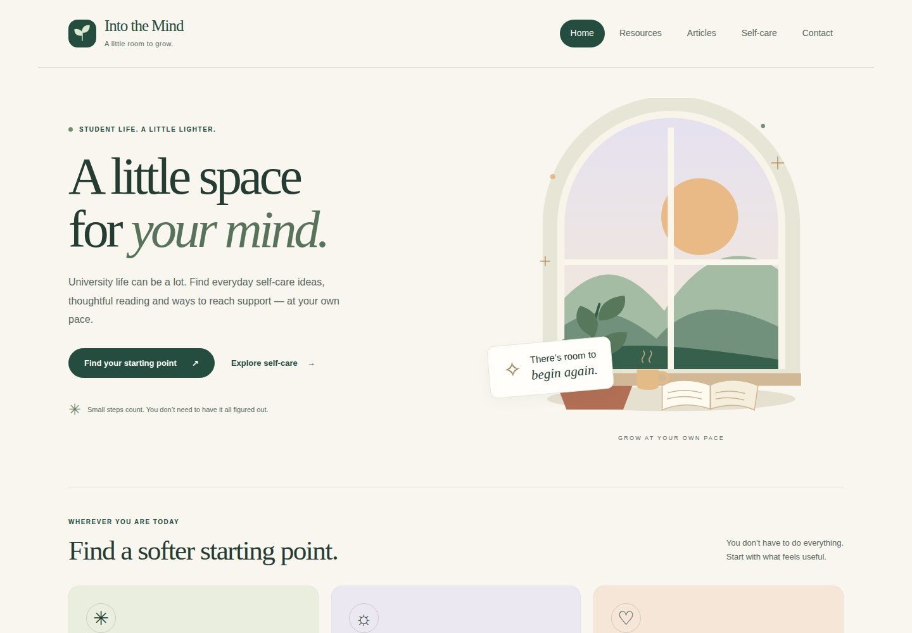
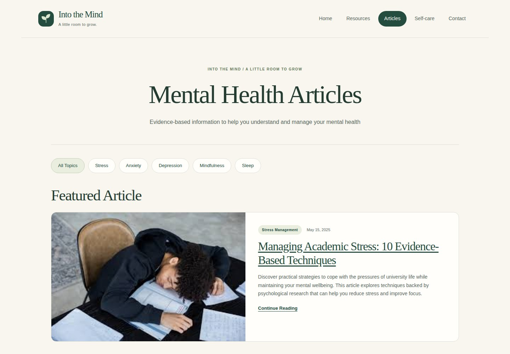
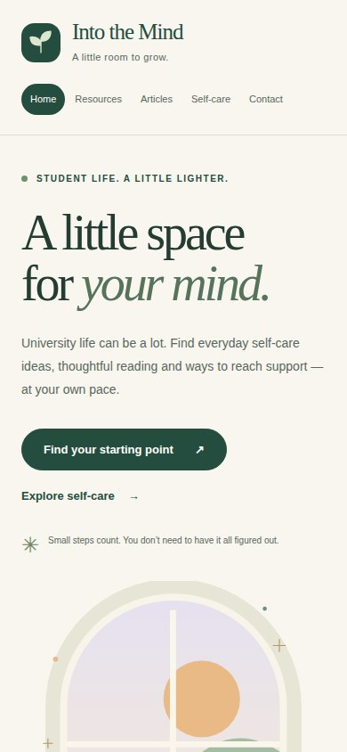

# Into The Mind

[](https://github.com/Nkosinathi-bit/into-the-mind-website/actions/workflows/site-check.yml)

**Academic web development project · HTML, CSS and JavaScript**

A multipage website exploring student wellbeing and mental-health awareness. Its visual system uses warm cream, forest green, sage, lavender and peach, with editorial typography, an original SVG illustration and responsive reading layouts.

This academic web development project combines responsive layouts, accessible navigation and practical browser-based tools.

## Visual preview

Actual Chromium browser captures of the running site. 




<details>
<summary>Article collection preview</summary>



</details>

<details>
<summary>Mobile browser preview</summary>



</details>

Desktop: 1440 × 1000 · Mobile: 390 × 844. [Capture source and provenance](docs/screenshots/capture.json).

## What is included

- A home page and a directory of student resources.
- An eight-article collection with live keyword search, topic filters and a saved reading list.
- CSS-based self-care and FAQ accordions.
- A focus timer with study, break and one-minute pause sessions, plus pause, resume and reset controls.
- A seven-day self-care tracker with progress and undo controls.
- Topic-based reading plans instead of inactive newsletter signups.
- A contact draft form with validation, preview, clear and text-file download controls.
- An accessibility statement describing the current prototype.

The website is an **educational demonstration**. The contact form does not send messages, and there is no mailing-list service. Resource listings and article content have not been independently validated as part of the technical maintenance of this project.

## View locally

Download the files and open `index.html` in a browser. Use a local web server for consistent saved-list and challenge progress across pages:

For a local web server, run from the repository root:

```bash
python -m http.server 8000
```

Then open [http://localhost:8000](http://localhost:8000).

## Technologies and implementation

| Area | Implementation |
| --- | --- |
| Structure | Semantic HTML, headings, navigation and form labels |
| Layout | CSS Grid, Flexbox and responsive media queries |
| Accessibility features | Skip links, keyboard focus styles, descriptive image text and reduced-motion CSS |
| Interaction | Shared deferred `script.js`, article filtering, saved reading list, focus timer, challenge tracking and message drafts |
| Browser storage | Only saved article filenames and completed challenge day numbers; unavailable storage falls back to the current visit |

Accessibility features are included in the source; this is not a claim of independent accessibility certification.

## Project structure

- `index.html` — home page
- `resources.html` — resource directory
- `articles.html` and `article-*.html` — article collection
- `self-care.html` — self-care layouts and accordions
- `contact.html` — contact form demonstration and FAQs
- `accessibility.html` — accessibility features and limitations
- `styles.css` — shared styles
- `script.js` — shared interactions, with no runtime dependencies
- `.github/scripts/check-site.cjs` — Chromium checks for interactions, persistence, keyboard use and responsive layouts
- `assets/` — the original SVG brand mark and calm window illustration
- `*.jpg` — article images stored at the repository root

## Current scope

The site runs as static HTML, CSS and JavaScript. It has no server, account system, mailing list or message delivery service. Name, email and message fields are never sent to a server or saved in browser storage. A downloaded message is a plain text file on the visitor's own device.

Article bookmarks and completed challenge days are stored under `into-the-mind:v1` in localStorage. Each can be undone using its button. Storage is local to the browser and site address, so different devices and browsers do not share progress. A visible note explains when the browser cannot save changes. Existing screenshots above show the original visual design, before the interactive tools were added.

## Browser checks

GitHub Actions runs `.github/scripts/check-site.cjs` on pushes and pull requests. It checks every HTML page at mobile, tablet and desktop widths, then exercises filters, saved articles across pages, reading plans, challenge persistence, timer transitions and message previews/downloads. It also checks storage failures and navigation without JavaScript.

To run it locally with Playwright and Chromium installed, start a local server on port `8765`, then run:

```bash
PLAYWRIGHT_MODULE_PATH=/path/to/node_modules/playwright node .github/scripts/check-site.cjs
```

**Author:** Nkosinathi Mathenjwa

